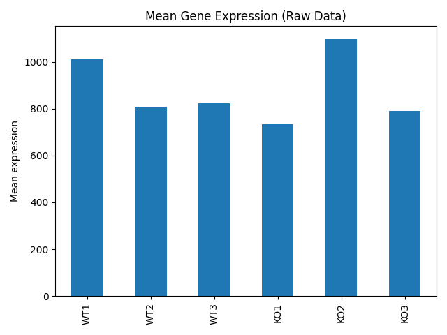
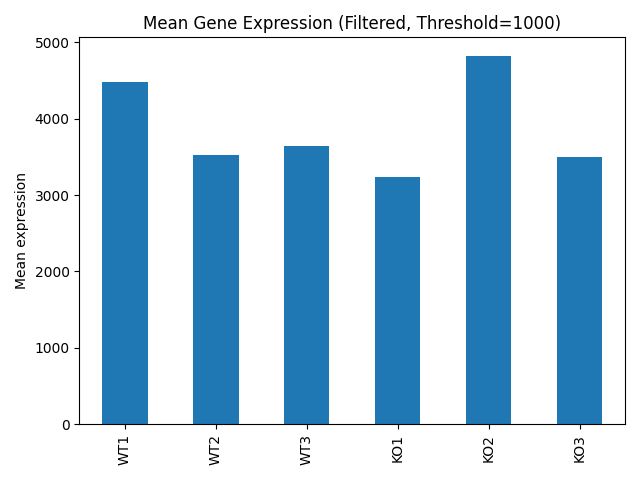

# Gene expression analysis in Python

I used Python to load gene expression counts, filter genes by their mean count, and compare sample means before and after filtering. I completed this project for my MSc coursework in Bioinformatics.

## Data

The coursework supplied `GSE81082_count_matrix.txt`, which contains 26,813 gene rows and six sample columns: WT1, WT2, WT3, KO1, KO2, and KO3. The first column contains gene identifiers.

This repository includes the supplied count matrix. The filename contains the accession GSE81082. The files supplied with this project do not document the upstream processing of the sequencing reads.

## Analysis

The script uses a parent class, `GeneExpressionData`, to load the tab-separated matrix with pandas. A child class, `RNASeqAnalysis`, calculates sample means, filters genes, and generates bar plots with matplotlib.

The workflow:

1. Load the count matrix and use the gene column as the index.
2. Calculate the mean count across all genes for each sample.
3. Plot the sample means before filtering.
4. Keep genes with a mean count strictly greater than 1,000 across the six samples.
5. Plot the sample means across the retained genes.

The script retains two equivalent implementations of the gene filter from the coursework. Both use pandas to calculate row means and select genes. This project makes no claim that one runs faster.

## Results

The filter retains 5,201 of the 26,813 gene rows.

### Before filtering



### After filtering



Each bar shows the mean count across the genes included in that plot. Filtering changes the set of genes used to calculate the means. These plots summarize raw counts and do not establish differential expression between WT and KO samples.

## Files

- `gene_expression_analysis.py`: classes and analysis workflow.
- `data/GSE81082_count_matrix.txt`: supplied coursework count matrix.
- `figures/mean_expression_raw.png`: sample means before filtering.
- `figures/mean_expression_filtered.png`: sample means after filtering.
- `requirements.txt`: Python dependencies.

## Run the analysis

Install Python 3, then open a terminal in the project folder and run:

```bash
python -m pip install -r requirements.txt
python gene_expression_analysis.py
```

On Windows, you can use `py` in place of `python` if that is how you launch Python.

The script prints the sample count and gene counts, then saves both plots in `figures/`. It resolves the data path relative to the script, so it also works when you launch it from another folder.

## Scope

This project demonstrates Python classes, inheritance, pandas calculations, expression filtering, and plotting. It uses raw counts without normalization or statistical comparisons between sample groups.
